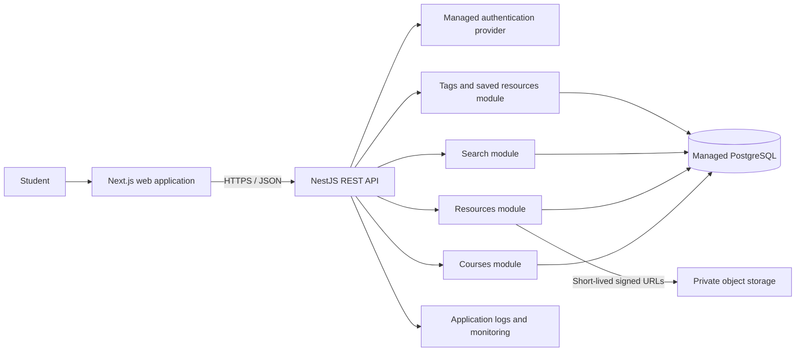

# StudyHub MVP Architecture Baseline

## Goal and scope

StudyHub provides students with a private, mobile-friendly place to organize course resources. The MVP covers student accounts, courses, resources (uploaded files and external links), tags, saved resources, and search. AI tutoring, forums, advanced analytics, institutional integrations, subscriptions, video delivery, and offline synchronization are deferred.

## Proposed architecture

Use a modular monolith for the MVP rather than introducing microservices. Keep authentication, courses, resources, search, and organization as distinct API modules.

## Technology choices (proposed)

| Area | Proposed choice | Status |
|---|---|---|
| Web application | React, Next.js, Tailwind CSS | Proposed |
| API | NestJS modular monolith, versioned REST | Proposed |
| Data | Managed PostgreSQL | Proposed |
| Authentication | Supabase Auth or equivalent managed provider | Provider to confirm |
| File storage | Private S3-compatible object storage | Provider to confirm |
| Search | PostgreSQL full-text search | Proposed for MVP |
| Hosting | Managed hosting for web and API | Provider to confirm |

## Main data entities

- `users`
- `courses`
- `resources`
- `tags`
- `resource_tags`
- `saved_resources`

Courses, resources, and tags are owned by an individual student. External links are stored as URL metadata; uploaded files are stored in private object storage. Deletion behavior and retention rules must be defined before implementation.

## API shape

Versioned endpoints under `/api/v1`:

- `/auth/*`
- `/courses/*`
- `/resources/*`
- `/search`
- `/saved/*`
- `/tags/*`

## Upload lifecycle

1. The student selects a supported file.
2. The API validates file metadata and configured limits.
3. The API creates a resource record in `PENDING_UPLOAD` state.
4. The API returns a short-lived signed upload URL.
5. The client uploads directly to private object storage.
6. The API verifies or confirms completion and marks the resource `AVAILABLE`.
7. On failure, the resource remains unavailable and the user receives a recoverable error.

The initial product notes propose PDF, PPT/PPTX, and DOC/DOCX support, a 25 MB per-file limit, and a 500 MB per-student storage allowance. These limits require confirmation before implementation.

## Security and privacy baseline

- Enforce authorization and ownership checks server-side for every operation.
- Keep courses, resources, and files private by default.
- Use short-lived signed URLs for uploads and downloads.
- Validate file extensions, MIME types, and configured size limits; generate storage object names rather than trusting user filenames.
- Rate-limit authentication endpoints.
- Define account deletion, resource deletion, retention, and recovery procedures.
- Test that one student cannot access another student's courses, resources, or files.
- Configure automated database backups and test recovery.
- Use HTTPS, application logs, and error/availability monitoring in deployed environments.

## Decisions to confirm

1. Authentication and object-storage providers
2. Maximum file size and per-student storage quota
3. Soft-delete versus permanent deletion and retention periods
4. Whether an administrative content-reporting workflow is required
5. Hosting providers and deployment environments
